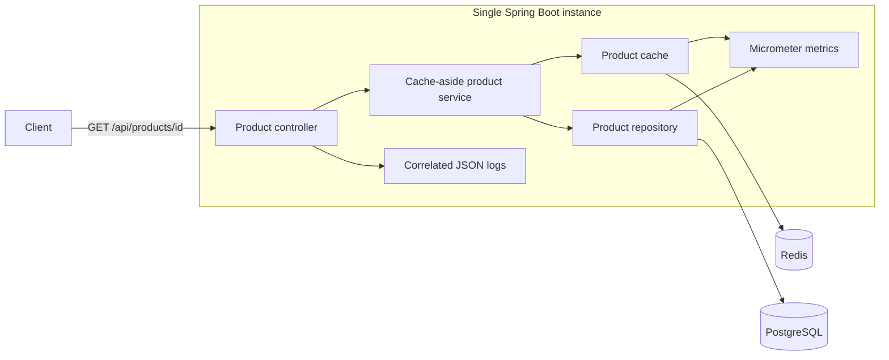

# Architecture

## Application and lab

One Java 25 / Spring Boot 4.1.2 application, one Maven module, capability packages,
and real Redis/PostgreSQL dependencies. Docker Compose publishes only the
application on `127.0.0.1:8080`.

`product` owns REST DTOs, lookup orchestration, explicit JDBC, and problem
responses. `cache` owns namespaced Redis JSON entries and an atomic SET with TTL.
`telemetry` owns request correlation. `configuration` owns validated cache TTL.
There are no speculative repository/cache interfaces or scenario plugins.

The cache-aside service is stateless. A cache hit avoids PostgreSQL. A miss queries
the synthetic fixture, writes the result with TTL, and returns it. A missing row
returns 404 without a cache write. Redis read/write/decoding failures return 503;
there is no retry or database fallback. JDBC and Redis clients are shared,
thread-safe infrastructure beans; request state stays local to the invocation.
Concurrent misses can issue duplicate SQL when coalescing is disabled. The
opt-in lab adds a controlled origin delay and single-instance coalescing.

Flyway creates the product table and one synthetic record. The durable store has
no product mutation API. Cache keys are `tracelens:product:v1:<id>`.

## Telemetry semantics

- `tracelens.cache.lookups{outcome=hit|miss|error}` and
  `tracelens.cache.writes{outcome=success|error}` describe actual cache operations.
- `tracelens.product.sql.attempts|successes|failures` describe product SELECTs only.
  A missing row is a successful SQL operation. Failed connection acquisition is
  not an executed product query. Migration and readiness SQL are excluded.
- `tracelens.product.sql.connection.acquire` times acquisition, including failed
  attempts; `tracelens.product.sql.duration` times execute/result consumption.
- `tracelens.product.sql.active` is a client-side outstanding-operation gauge.
  Its decrement is in `finally`. It is not a PostgreSQL active-query measurement.
- Boot HTTP timers and structured API completion logs expose status and timing.
  Correlation IDs are bounded/sanitized and stored in MDC only during the request.
  IDs and product IDs are not metric tags.

Micrometer metrics are process-cumulative. The lab separately records exact
cohort observations on request threads, then returns them after server-side drain.
Do not use scraped cumulative counters as an exact experiment report.

## Resource and safety boundaries

The pool has 16 connections. Redis commands, connection acquisition, SQL, driver
network operations, and graceful shutdown are bounded. There is no total HTTP
request deadline yet. Custom connection URLs must preserve network timeouts.
Actuator exposes only health and metrics, with health details hidden.
No credentials are stored in source. `.env` is ignored and excluded from the
Docker build context. Only use isolated local targets.

## Lab lifecycle

The `experiment` entry point runs as a separate one-off Compose container, calls
the fixed `app:8080` target, and writes JSON and Markdown to a bind mount. The
lab profile validates a token and the expected local service names and resource
defaults. Its controls and product requests require the shared token. The Docker
host and network remain trusted; the token is not an internet-facing security
boundary. Normal startup does not register lab controls.

One synchronized coordinator tracks all product requests before admitting a
session. Preparation is exclusive and remains guarded while it touches Redis and
PostgreSQL. It rejects unrelated traffic during a session, accepts each request ID
once for the open cohort, binds requests to the session, rejects reused cohort IDs,
and rejects late arrivals. The runner closes admission
before collecting observations. It cannot start the next cohort until server
requests and SQL drain. A 30-second control lease closes admission on the next
interaction after runner loss; if work is still active, the guard remains until
it drains. Only the owned product key is evicted during preparation and cleanup.

In mitigation mode, a per-key future is inserted atomically. Its leader rechecks
Redis, queries and caches on a miss, completes the future, and removes the exact
entry in `finally`. Followers share the result or failure, wait at most four
seconds, and never cancel the leader. A later request can recover from a failed
load. This guarantee is limited to one JVM, not application replicas.

Each request retains a thread-local cohort observation until it leaves the
filter; run-local counts do not depend on metric scrapes or trace sampling.
The runner records client dispatch and terminal latency separately from server
SQL and pool-wait timings. Their monotonic clocks have different origins. Lab
SQL adds the documented synthetic sleep inside the measured SELECT. Reports
distinguish valid assertion failures, inconclusive amplification, and invalid
execution.

## Optional tracing

The tracing Compose override adds the OpenTelemetry Java agent to the runner and
application and sends traces via OTLP/HTTP to an isolated Jaeger instance. W3C
context connects each runner request to the HTTP server span. Explicit cache,
coalescing, and origin spans describe the application path; JDBC spans provide
database detail. A follower waits in its own trace, while the leader's database
work belongs to the leader's trace. Run, cohort, and request IDs are span
attributes, never metric labels. The report records trace IDs and configured
settings but does not claim that a collector received or retained the spans.
Tracing is optional, and run-local counters remain the assertion source.
